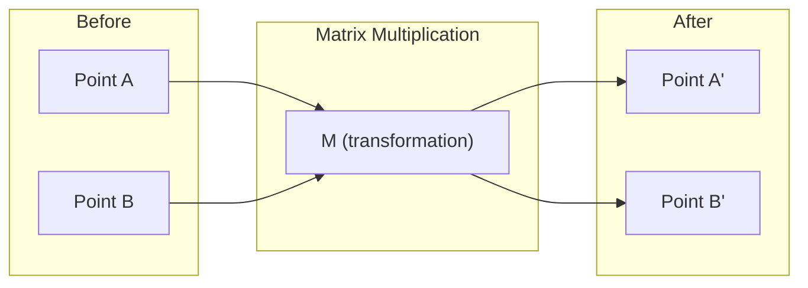
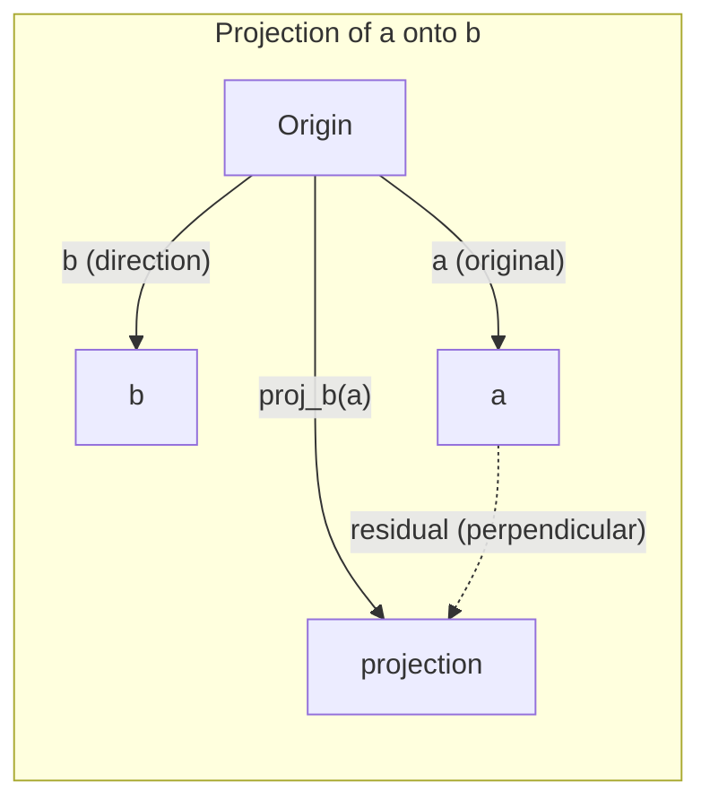

> **课文中译** · Phase 01 · 第 01 节
> 原文：`phases/01-math-foundations/01-linear-algebra-intuition/docs/en.md`
> （在 `~/workspace/ai-engineering-from-scratch`，那个 clone 保持只读）
>
> 配套的手写代码在同目录 [`01_linear_algebra.py`](01_linear_algebra.py)。
>
> ⚠ 原文的公式是 LaTeX，本地预览器大多渲染不出来，**本译本已全部改写成纯文本图示** ——
> 好处是哪儿都能看，代价是不会像 GitHub 上的原文那样排成漂亮公式。
> 其中「为什么点积的正负号能代表方向」一段是补的，原文跳过了。

---

# 线性代数直觉

> 每一个 AI 模型，都只是披了件花衣裳的矩阵运算。

**类型：** 学习
**语言：** Python、Julia
**前置：** Phase 0
**时长：** 约 60 分钟

## 学习目标

- 用 Python 从零实现向量和矩阵运算（加法、点积、矩阵乘法）
- 从几何上解释点积、投影、Gram-Schmidt 过程到底在做什么
- 用行化简判断一组向量的线性无关性、秩和基
- 把线性代数的概念和它在 AI 里的落点对上：嵌入向量、注意力分数、LoRA

## 问题在哪

随便翻开一篇机器学习论文，第一页之内你就会看到向量、矩阵、点积、变换。没有线性代数直觉，这些就只是符号。有了它，你能看见神经网络实际在做什么 —— **把空间里的点搬来搬去**。

你不需要成为数学家。你需要的是**看见这些运算在几何上意味着什么**，然后自己把它们写出来。

## 概念

### 向量就是点（也是方向）

向量就是一串数字。但这串数字是有含义的 —— 它们是空间中的坐标。

**二维向量 [3, 2]：**

| x | y | 点 |
|---|---|-----|
| 3 | 2 | 这个向量从原点 (0,0) 指向平面上的 (3, 2) |

它的模长是 `√(3² + 2²) = √13`，方向朝右上方。

在 AI 里，向量用来表示一切：

- 一个词 → 一个 768 维的向量（它在嵌入空间里的「含义」）
- 一张图 → 一个由几百万像素值组成的向量
- 一个用户 → 一个偏好向量

### 矩阵就是变换

矩阵把一个向量变成另一个向量。它能旋转、缩放、拉伸、投影。



在 AI 里，**矩阵就是模型本身**：

- 神经网络的权重 → 把输入变换成输出的矩阵
- 注意力分数 → 决定该关注什么的矩阵
- 嵌入 → 把词映射成向量的矩阵

### 点积衡量相似度

两个向量的点积告诉你它们有多像。

```
定义：对应位置相乘，然后全部加起来

    a · b  =  a₁×b₁ + a₂×b₂ + ⋯ + aₙ×bₙ


算出来那个数的正负号，告诉你两条向量的方向关系：

    同向    a · b  >  0     夹角 < 90°    相似
    垂直    a · b  =  0     夹角 = 90°    无关
    反向    a · b  <  0     夹角 > 90°    相反
```

为什么正负号能代表方向？因为点积还有一个等价写法：

```
    a · b  =  |a| × |b| × cos θ
              └──────┬──────┘  └─┬─┘
                 长度，恒为正     只有它能变号
```

长度永远是正的，所以整个式子的符号**完全由 cos θ 决定**。

⚠ 这同时说明：**点积 = 长度 × 长度 × 方向，三样混在一起。** 把两个长度除掉，
剩下的 cos θ 才是纯方向 —— 那就是余弦相似度。所以「点积当相似度」只在
向量已归一化（长度都是 1）的时候才成立。

搜索引擎、推荐系统、RAG 的原理就是这个 —— 找点积高的向量。

### 线性无关

如果一组向量里，没有任何一个能由其余的线性组合写出来，它们就是**线性无关**的。如果 `v₁、v₂、v₃` 无关，它们张成一个三维空间。如果其中一个是另外两个的组合，它们只张成一个平面。

**为什么对 AI 重要：** 你的特征矩阵的列应该线性无关。如果两个特征完全相关（线性相关），模型就无法区分它们各自的作用。这在回归里叫**多重共线性** —— 权重矩阵变得不稳定，输入的微小变化会让输出剧烈摆动。

**具体例子：**

```
v1 = [1, 0, 0]
v2 = [0, 1, 0]
v3 = [2, 1, 0]   # v3 = 2*v1 + v2
```

`v₁` 和 `v₂` 无关 —— 谁都不是对方的倍数或组合。但 `v₃ = 2v₁ + v₂`，所以 `{v₁, v₂, v₃}` 整体是相关的。这三个向量全都躺在 xy 平面上。不管你怎么组合，都够不到 [0, 0, 1]。**你有三个向量，却只有两个自由度。**

放到数据集里：如果 feature_3 = 2*feature_1 + feature_2，那么加上 feature_3 给模型带来的信息是**零**。更糟的是它让正规方程变成奇异的 —— 权重根本没有唯一解。

### 基与秩

**基**是一组最小的、线性无关的、能张满整个空间的向量。基向量的个数就是这个空间的维数。

三维空间的标准基是 {[1,0,0], [0,1,0], [0,0,1]}。但三维里任意三个无关向量都构成一组合法的基。**选哪组基，就是选一个坐标系。**

矩阵的**秩** = 线性无关的列数 = 线性无关的行数。如果 `秩 < min(行数, 列数)`，这个矩阵就是**亏秩**的。这意味着：

- 方程组有无穷多解（或者无解）
- 变换过程中丢失了信息
- 矩阵不可逆

| 情形 | 秩 | 对机器学习意味着什么 |
|-----------|------|---------------------|
| 满秩 `秩 = min(m, n)` | 达到上限 | 最小二乘有唯一解。模型良态。 |
| 亏秩 `秩 < min(m, n)` | 低于上限 | 特征冗余。权重有无穷多组解。需要正则化。 |
| 秩为 1 | 1 | 每一列都是同一个向量的缩放。所有数据落在一条直线上。 |
| 接近亏秩（存在很小的奇异值）| 数值上偏低 | 矩阵病态。输入的微小噪声会造成输出的大幅变化。用 SVD 截断或岭回归。 |

### 投影

把向量 **a** 投影到向量 **b** 上，得到的是 **a** 在 **b** 方向上的分量：

```
                  a · b
    proj_b(a)  =  ─────  ×  b
                  b · b
                  └──┬──┘
             一个标量：a 在 b 方向上「有多少」
             再乘回 b，把它变成一个向量
```

残差 `a − proj_b(a)` 与 `b` 垂直。**这种正交分解是最小二乘拟合的基础。**

投影在机器学习里无处不在：

- 线性回归最小化观测值到列空间的距离 —— 那个解**本身就是一次投影**
- PCA 把数据投影到方差最大的几个方向上
- Transformer 里的注意力，计算的是 query 到 key 的投影



**例子：** `a = [3, 4]`，`b = [1, 0]`

```
    proj_b(a) = (3×1 + 4×0) / (1×1 + 0×0) × [1, 0]
              = 3/1 × [1, 0]
              = [3, 0]
```

**投影把 y 分量丢掉了。这就是最简单形式的降维 —— 把你不关心的方向扔掉。**

### Gram-Schmidt 过程

把任意一组无关向量，变成一组**标准正交基**。标准正交的意思是：每个向量长度为 1，任意两个互相垂直。

算法：

1. 取第一个向量，归一化
2. 取第二个向量，减掉它在第一个上的投影，归一化
3. 取第三个向量，减掉它在前面所有向量上的投影，归一化
4. 其余向量依此类推

```
输入：  v1, v2, v3, ... （线性无关）

u1 = v1 / |v1|

w2 = v2 - (v2 dot u1) * u1
u2 = w2 / |w2|

w3 = v3 - (v3 dot u1) * u1 - (v3 dot u2) * u2
u3 = w3 / |w3|

输出：  u1, u2, u3, ... （标准正交基）
```

**QR 分解内部就是这么工作的。** Q 是那组标准正交基，R 记录投影系数。QR 分解用在：

- 解线性方程组（比高斯消元更稳定）
- 计算特征值（QR 算法）
- 最小二乘回归（标准的数值方法）

```figure
eigen-directions
```

## 动手写（Build It）

### 第 1 步：从零写向量（Python）

```python
class Vector:
    def __init__(self, components):
        self.components = list(components)
        self.dim = len(self.components)

    def __add__(self, other):
        return Vector([a + b for a, b in zip(self.components, other.components)])

    def __sub__(self, other):
        return Vector([a - b for a, b in zip(self.components, other.components)])

    def dot(self, other):
        return sum(a * b for a, b in zip(self.components, other.components))

    def magnitude(self):
        return sum(x**2 for x in self.components) ** 0.5

    def normalize(self):
        mag = self.magnitude()
        return Vector([x / mag for x in self.components])

    def cosine_similarity(self, other):
        return self.dot(other) / (self.magnitude() * other.magnitude())

    def __repr__(self):
        return f"Vector({self.components})"


a = Vector([1, 2, 3])
b = Vector([4, 5, 6])

print(f"a + b = {a + b}")
print(f"a · b = {a.dot(b)}")
print(f"|a| = {a.magnitude():.4f}")
print(f"cosine similarity = {a.cosine_similarity(b):.4f}")
```

### 第 2 步：从零写矩阵（Python）

```python
class Matrix:
    def __init__(self, rows):
        self.rows = [list(row) for row in rows]
        self.shape = (len(self.rows), len(self.rows[0]))

    def __matmul__(self, other):
        if isinstance(other, Vector):
            return Vector([
                sum(self.rows[i][j] * other.components[j] for j in range(self.shape[1]))
                for i in range(self.shape[0])
            ])
        rows = []
        for i in range(self.shape[0]):
            row = []
            for j in range(other.shape[1]):
                row.append(sum(
                    self.rows[i][k] * other.rows[k][j]
                    for k in range(self.shape[1])
                ))
            rows.append(row)
        return Matrix(rows)

    def transpose(self):
        return Matrix([
            [self.rows[j][i] for j in range(self.shape[0])]
            for i in range(self.shape[1])
        ])

    def __repr__(self):
        return f"Matrix({self.rows})"


rotation_90 = Matrix([[0, -1], [1, 0]])
point = Vector([3, 1])

rotated = rotation_90 @ point
print(f"Original: {point}")
print(f"Rotated 90°: {rotated}")
```

### 第 3 步：这为什么对 AI 重要

```python
import random

random.seed(42)
weights = Matrix([[random.gauss(0, 0.1) for _ in range(3)] for _ in range(2)])
input_vector = Vector([1.0, 0.5, -0.3])

output = weights @ input_vector
print(f"Input (3D): {input_vector}")
print(f"Output (2D): {output}")
print("This is what a neural network layer does -- matrix multiplication.")
```

### 第 4 步：Julia 版本

```julia
a = [1.0, 2.0, 3.0]
b = [4.0, 5.0, 6.0]

println("a + b = ", a + b)
println("a · b = ", a ⋅ b)       # Julia supports unicode operators
println("|a| = ", √(a ⋅ a))
println("cosine = ", (a ⋅ b) / (√(a ⋅ a) * √(b ⋅ b)))

# Matrix-vector multiplication
W = [0.1 -0.2 0.3; 0.4 0.5 -0.1]
x = [1.0, 0.5, -0.3]
println("Wx = ", W * x)
println("This is a neural network layer.")
```

### 第 5 步：从零写线性无关判定与投影（Python）

```python
def is_linearly_independent(vectors):
    n = len(vectors)
    dim = len(vectors[0].components)
    mat = Matrix([v.components[:] for v in vectors])
    rows = [row[:] for row in mat.rows]
    rank = 0
    for col in range(dim):
        pivot = None
        for row in range(rank, len(rows)):
            if abs(rows[row][col]) > 1e-10:
                pivot = row
                break
        if pivot is None:
            continue
        rows[rank], rows[pivot] = rows[pivot], rows[rank]
        scale = rows[rank][col]
        rows[rank] = [x / scale for x in rows[rank]]
        for row in range(len(rows)):
            if row != rank and abs(rows[row][col]) > 1e-10:
                factor = rows[row][col]
                rows[row] = [rows[row][j] - factor * rows[rank][j] for j in range(dim)]
        rank += 1
    return rank == n


def project(a, b):
    scalar = a.dot(b) / b.dot(b)
    return Vector([scalar * x for x in b.components])


def gram_schmidt(vectors):
    orthonormal = []
    for v in vectors:
        w = v
        for u in orthonormal:
            proj = project(w, u)
            w = w - proj
        if w.magnitude() < 1e-10:
            continue
        orthonormal.append(w.normalize())
    return orthonormal


v1 = Vector([1, 0, 0])
v2 = Vector([1, 1, 0])
v3 = Vector([1, 1, 1])
basis = gram_schmidt([v1, v2, v3])
for i, u in enumerate(basis):
    print(f"u{i+1} = {u}")
    print(f"  |u{i+1}| = {u.magnitude():.6f}")

print(f"u1 · u2 = {basis[0].dot(basis[1]):.6f}")
print(f"u1 · u3 = {basis[0].dot(basis[2]):.6f}")
print(f"u2 · u3 = {basis[1].dot(basis[2]):.6f}")
```

## 换成库（Use It）

同样的事，用 NumPy 再做一遍 —— 这才是实际工作里用的：

```python
import numpy as np

a = np.array([1, 2, 3], dtype=float)
b = np.array([4, 5, 6], dtype=float)

print(f"a + b = {a + b}")
print(f"a · b = {np.dot(a, b)}")
print(f"|a| = {np.linalg.norm(a):.4f}")
print(f"cosine = {np.dot(a, b) / (np.linalg.norm(a) * np.linalg.norm(b)):.4f}")

W = np.random.randn(2, 3) * 0.1
x = np.array([1.0, 0.5, -0.3])
print(f"Wx = {W @ x}")
```

### 用 NumPy 算秩、投影和 QR

```python
import numpy as np

A = np.array([[1, 2], [2, 4]])
print(f"Rank: {np.linalg.matrix_rank(A)}")

a = np.array([3, 4])
b = np.array([1, 0])
proj = (np.dot(a, b) / np.dot(b, b)) * b
print(f"Projection of {a} onto {b}: {proj}")

Q, R = np.linalg.qr(np.random.randn(3, 3))
print(f"Q is orthogonal: {np.allclose(Q @ Q.T, np.eye(3))}")
print(f"R is upper triangular: {np.allclose(R, np.triu(R))}")
```

### PyTorch —— 张量就是带自动求导的向量

```python
import torch

x = torch.randn(3, requires_grad=True)
y = torch.tensor([1.0, 0.0, 0.0])

similarity = torch.dot(x, y)
similarity.backward()

print(f"x = {x.data}")
print(f"y = {y.data}")
print(f"dot product = {similarity.item():.4f}")
print(f"d(dot)/dx = {x.grad}")
```

**点积对 x 的梯度就是 y 本身。** PyTorch 自动算出了这个。神经网络里的每一个运算，都是由这种运算搭起来的 —— 矩阵乘、点积、投影 —— 而自动微分会贯穿它们全部去追踪梯度。

你刚刚从零写出了 NumPy 一行就能做的事。**现在你知道那一行底下在发生什么了。**

## 产出（Ship It）

本节产出：

- `outputs/prompt-linear-algebra-tutor.md` —— 一个让 AI 助手用几何直觉来讲线性代数的提示词

## 连接到哪里

本节的每一样东西，都连着现代 AI 的某个具体部件：

| 概念 | 出现在哪 |
|---------|------------------|
| 点积 | Transformer 的注意力分数、RAG 里的余弦相似度 |
| 矩阵乘法 | 每一层神经网络，每一次线性变换 |
| 线性无关 | 特征选择、规避多重共线性 |
| 秩 | 判断方程组是否可解、**LoRA（低秩适配）** |
| 投影 | 线性回归（投到列空间上）、PCA |
| Gram-Schmidt / QR | 数值求解器、特征值计算 |
| 标准正交基 | 稳定的数值计算、白化变换 |

**LoRA 值得单拎出来说。** 它微调大语言模型的办法，是把权重更新**分解成低秩矩阵**。与其更新一个 4096×4096 的权重矩阵（1600 万参数），LoRA 更新的是两个 4096×16 和 16×4096 的矩阵（**13.1 万参数**）。

那个「秩为 16」的约束意味着：**LoRA 假设权重更新住在整个 4096 维空间的一个 16 维子空间里。** 这就是线性代数在干真活。

## 练习

1. 实现 `Vector.angle_between(other)`，返回两个向量之间的夹角（度）
2. 构造一个二维缩放矩阵，让 x 坐标变成 2 倍、y 坐标变成 3 倍，然后作用在向量 [1, 1] 上
3. 给定 5 个随机的「类词向量」（50 维），用余弦相似度找出最相似的两个
4. 验证 Gram-Schmidt 的输出确实是标准正交的：检查任意两个的点积为 0，且每个模长为 1
5. 构造一个秩为 2 的 3×3 矩阵。用 `rank()` 方法验证。然后说明它的列张成的是什么几何对象
6. 把向量 [1, 2, 3] 投影到 [1, 1, 1] 上。结果在几何上代表什么？

## 关键术语

| 术语 | 一般人怎么说 | 它实际是什么 |
|------|----------------|----------------------|
| 向量 Vector | 「一个箭头」 | 一串数字，表示 n 维空间里的一个点或一个方向 |
| 矩阵 Matrix | 「一张数字表」 | 一次变换，把向量从一个空间映射到另一个空间 |
| 点积 Dot product | 「对应相乘再求和」 | 衡量两个向量有多对齐 —— 相似度检索的核心 |
| 嵌入 Embedding | 「某种 AI 魔法」 | 一个表示某样东西（词、图、用户）含义的向量 |
| 线性无关 | 「它们不重叠」 | 这组里没有任何一个能写成其余的线性组合 |
| 秩 Rank | 「有多少维」 | 矩阵中线性无关的列（或行）的个数 |
| 投影 Projection | 「影子」 | 一个向量在另一个向量方向上的分量 |
| 基 Basis | 「坐标轴」 | 一组最小的、无关的、能张满该空间的向量 |
| 标准正交 Orthonormal | 「互相垂直的单位向量」 | 两两垂直、且每个长度都为 1 的一组向量 |
